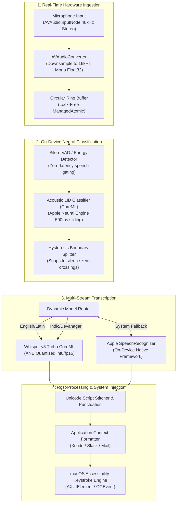

# ARCHITECTURE.md — CodeSwitch Voice Architecture

> Audio capture, neural language identification, multi-stream decoding, and text injection architecture for CodeSwitch Voice.

---

## 🏗️ 1. Streaming Audio Pipeline Architecture



---

## 🔄 2. Lock-Free Audio Ring Buffer Architecture

To decouple the real-time audio input callback from neural inference on the Apple Neural Engine, audio is passed through a lock-free circular ring buffer:

```swift
import Atomics
import Foundation

public final class LockFreeAudioRingBuffer: @unchecked Sendable {
    private let capacity: Int
    private let buffer: UnsafeMutablePointer<Float>
    private let writeIndex = ManagedAtomic<Int>(0)
    private let readIndex = ManagedAtomic<Int>(0)
    
    public init(capacity: Int = 16000 * 10) { // 10 seconds of 16kHz audio
        self.capacity = capacity
        self.buffer = .allocate(capacity: capacity)
        self.buffer.initialize(repeating: 0.0, count: capacity)
    }
    
    deinit {
        buffer.deallocate()
    }
    
    public func write(samples: UnsafePointer<Float>, count: Int) {
        let currentWrite = writeIndex.load(ordering: .relaxed)
        for i in 0..<count {
            buffer[(currentWrite + i) % capacity] = samples[i]
        }
        writeIndex.wrappingIncrement(by: count, ordering: .releasing)
    }
    
    public func read(into output: UnsafeMutablePointer<Float>, count: Int) -> Bool {
        let currentRead = readIndex.load(ordering: .relaxed)
        let currentWrite = writeIndex.load(ordering: .acquiring)
        guard (currentWrite - currentRead) >= count else { return false }
        
        for i in 0..<count {
            output[i] = buffer[(currentRead + i) % capacity]
        }
        readIndex.wrappingIncrement(by: count, ordering: .releasing)
        return true
    }
}
```

---

## ⌨️ 3. Direct System Text Injection (`AXUIElement`)

CodeSwitch Voice injects transcribed text directly at the user's cursor without requiring manual clipboard pastes:

```swift
import ApplicationServices
import AppKit

public final class TextInjector {
    public static func inject(text: String) {
        // 1. Attempt Accessibility API replacement on focused UI element
        let systemWide = AXUIElementCreateSystemWide()
        var focusedElement: AnyObject?
        let result = AXUIElementCopyAttributeValue(systemWide, kAXFocusedUIElementAttribute as CFString, &focusedElement)
        
        if result == .success, let element = focusedElement as! AXUIElement? {
            let stringValue = text as CFTypeRef
            let setResult = AXUIElementSetAttributeValue(element, kAXSelectedTextAttribute as CFString, stringValue)
            if setResult == .success { return }
        }
        
        // 2. Fallback: Fast clipboard pasteboard simulation
        let pasteboard = NSPasteboard.general
        pasteboard.clearContents()
        pasteboard.setString(text, forType: .string)
        
        // Simulate Cmd+V keystroke
        let src = CGEventSource(stateID: .combinedSessionState)
        let vDown = CGEvent(keyboardEventSource: src, virtualKey: 0x09, keyDown: true)
        vDown?.flags = .maskCommand
        let vUp = CGEvent(keyboardEventSource: src, virtualKey: 0x09, keyDown: false)
        vUp?.flags = .maskCommand
        
        vDown?.post(tap: .cghidEventTap)
        vUp?.post(tap: .cghidEventTap)
    }
}
```
